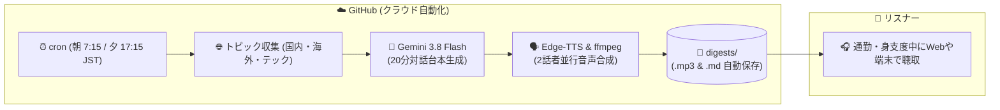

# daily-topics 🎙🤖

[](https://opensource.org/licenses/MIT)
[](https://www.python.org/)
[](https://ai.google.dev/)
[](https://github.com/rany2/edge-tts)
[](https://github.com/features/actions)

GitHub Actions と Google Gemini、Edge-TTS を活用し、**朝夕2回（7:15 / 17:15）、2人のホストによる約20分の本格的な対話型ポッドキャスト（NotebookLM風）を完全自動で生成・配信・蓄積するOSSテンプレート** です。

---

## 🎧 主な特徴

- **完全無料・サーバー不要（Serverless）**:
  - GitHub Actions の cron で朝夕2回クラウド自動実行。
  - Gemini API 無料枠 ＋ 完全無料・高品質な Microsoft Edge 音声エンジン（Edge-TTS）を採用。
- **NotebookLM スタイルの2人掛け合い（マルチスピーカー）**:
  - **Keita（男性声・解説役）** と **Nanami（女性声・進行役）** が、素朴な疑問や相槌を交えながらディープにディスカッション。
- **3大ジャンルを徹底網羅（各約5〜6分・合計20分）**:
  - 🇯🇵 **国内ニュース**: 国内の政治・経済・社会の注目トピック
  - 🌍 **海外・国際情勢**: 世界の主要ニュース・国際関係・グローバルトレンド
  - 💻 **最新テック・AI最前線**: AI、最新ガジェット、開発トレンド、Webの話題
- **外部設定ファイル（`config.yaml`）で簡単カスタマイズ**:
  - 好きなニュースRSS、話者名、声質、配信時間をコードを触らずに変更可能。
- **全編テキスト書き起こし（トランスクリプト）付き**:
  - 音声だけでなく、記事リンク付きMarkdownサマリーと二人の会話全編ログを自動保存。

---

## 🏗 システムアーキテクチャ



---

## 🚀 3ステップ・クイックスタート

誰でも **約3分** で自分専用のAIポッドキャスト自動配信を始められます！

### 1. リポジトリを Fork またはテンプレート作成
* 本リポジトリ右上の **「Use this template」**（または **「Fork」**）をクリックし、ご自身のアカウントにリポジトリを作成します。

### 2. Gemini API キーの登録
1. [Google AI Studio](https://aistudio.google.com/) から無料の Gemini API キーを取得します（クレジットカード不要）。
2. あなたのリポジトリの **Settings** > **Secrets and variables** > **Actions** を開きます。
3. **New repository secret** をクリックし、以下を登録します：
   * **Name**: `GEMINI_API_KEY`
   * **Secret**: 取得したAPIキー

### 3. GitHub Actions の書き込み権限を有効化
1. リポジトリの **Settings** > **Actions** > **General** を開きます。
2. ページ下部の **Workflow permissions** で **「Read and write permissions」** を選択し、**Save** をクリックします。

🎉 **セットアップ完了！**
あとは毎朝 7:15 と毎夕 17:15 に自動で番組が生成されます。
今すぐ聴きたい場合は、**Actions タブ** > **「Daily 20-Min Topic Podcast」** > **「Run workflow」** から即座に手動実行できます！

---

## ⚙️ 設定カスタマイズ (`config.yaml`)

[`config.yaml`](config.yaml)（または `config.example.yaml`）を編集することで、番組内容を自由にカスタマイズできます：

```yaml
# 話者の名前・声の変更
speakers:
  host1:
    name: "Keita"
    voice: "ja-JP-KeitaNeural" # 落ち着いた男性声
    role: "解説役（背景やポイントを解説）"
  host2:
    name: "Nanami"
    voice: "ja-JP-NanamiNeural" # 明るい女性声
    role: "進行役（素朴な疑問や相槌を挟む）"

# ニュースRSSの変更・追加
categories:
  tech:
    name: "最新テック・AIトレンド"
    limit_per_feed: 4
    feeds:
      - name: "Google News (テクノロジー)"
        url: "https://news.google.com/rss/headlines/section/topic/TECHNOLOGY?hl=ja&gl=JP&ceid=JP:ja"
      # あなたの好きなRSSを追加可能！
```

---

## 💻 ローカル開発 & ドライラン

APIキーを使わずに、設定ファイルとトピック収集パイプラインを即座にローカルテストできます：

```bash
# 依存関係のインストール
pip install -r requirements.txt

# ドライラン実行（API消費なし・0秒で検証）
python3 src/main.py --dry-run
```

---

## 📢 最近のポッドキャスト
<!-- LATEST_DIGESTS -->
- 📅 [サンプル放送（朝の便）](digests/sample_morning.md)

---

## 🗺️ ロードマップ

- [x] 朝夕2回・20分・2話者対話ポッドキャストの自動生成
- [x] 設定の外部化（`config.yaml`）と `--dry-run` テスト機能
- [x] OSS テンプレート化（MIT License、CONTRIBUTING、Issue/PRテンプレート）
- [ ] 自宅PCをサーバーとする Web アプリケーション連携（Step 2）
- [ ] ポッドキャスト RSS フィード生成（Apple Podcasts / Spotify 購読対応）

---

## 🤝 コントリビューション

バグ報告や機能提案、プルリクエストを歓迎しています！詳しくは [CONTRIBUTING.md](CONTRIBUTING.md) をご覧ください。

---

## 📄 ライセンス

本プロジェクトは [MIT License](LICENSE) の下で公開されています。
